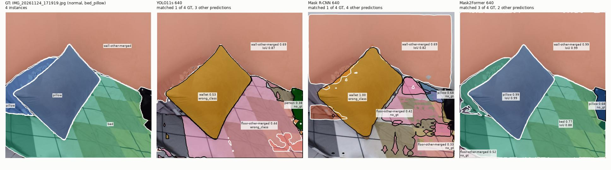
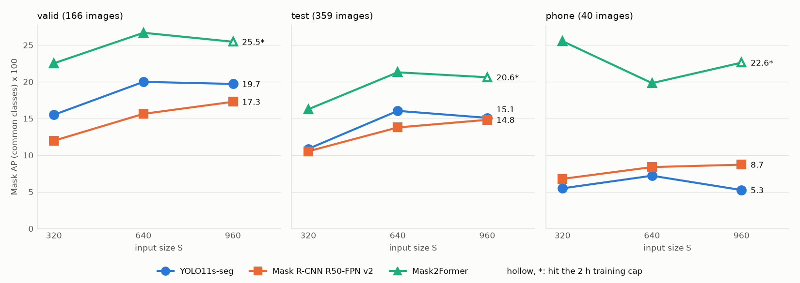
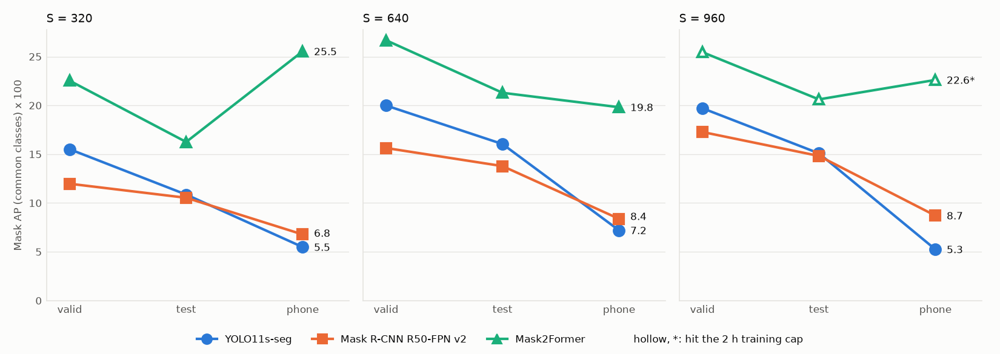
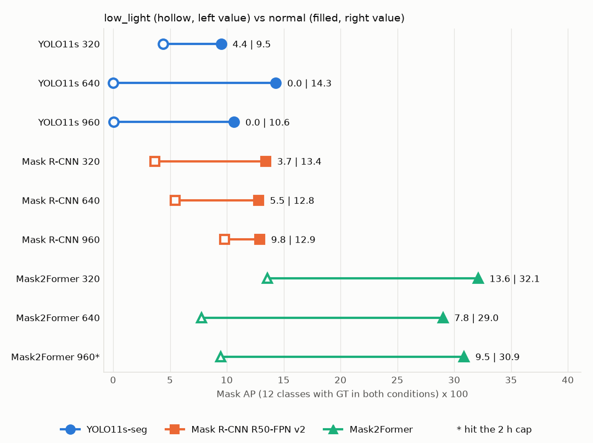
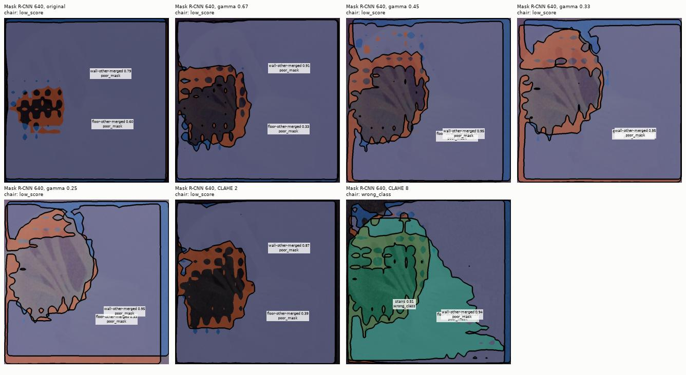
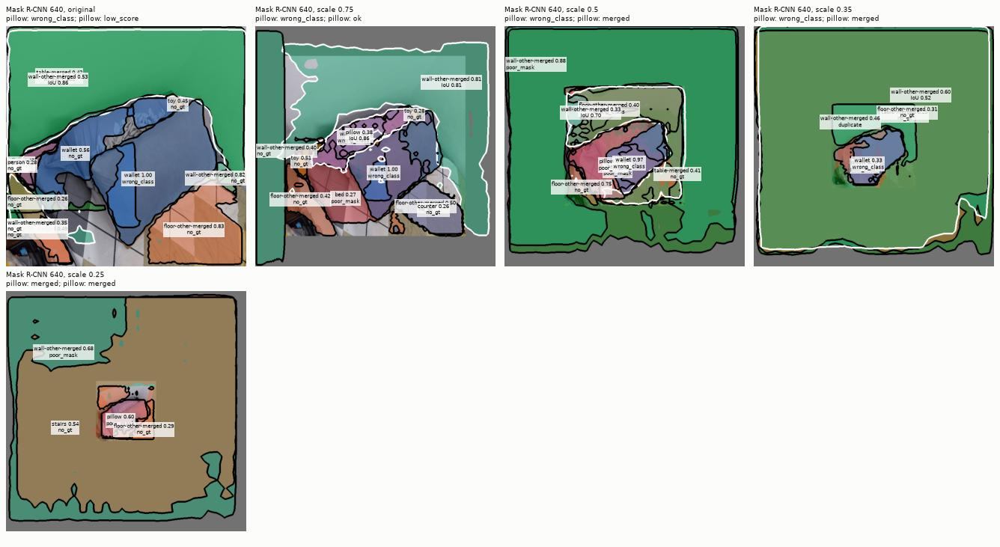
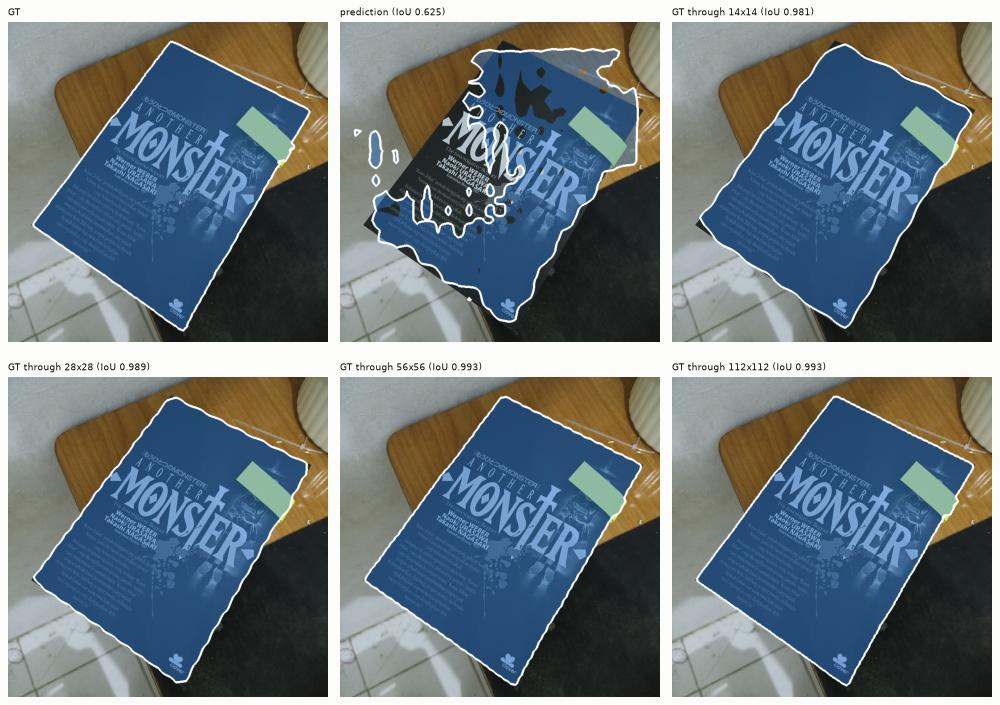
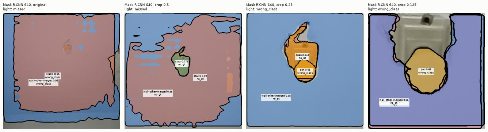
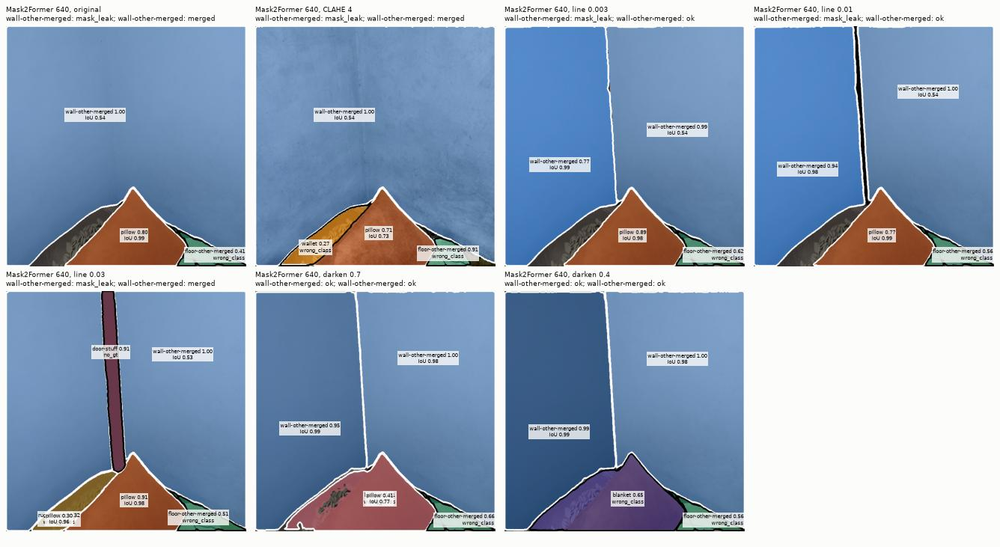

<div align="center">

<h1>When the Room Changes</h1>

<p>Instance segmentation of indoor scenes under domain shift: YOLO11s-seg, Mask R-CNN, and Mask2Former, each trained at input size 320, 640, and 960 on Panoptic Indoor Segmentation v5, scored by one evaluator on three test levels that end with 40 phone photos, and five failures tested with small experiments.</p>

<p>


</p>

<p>
<a href="#the-method"><b>Method</b></a> ·
<a href="#results"><b>Results</b></a> ·
<a href="#failure-analysis"><b>Failure analysis</b></a> ·
<a href="#reproducing"><b>Reproducing</b></a> ·
<a href="#limitations"><b>Limitations</b></a> ·
<a href="https://github.com/luminolous/indoor-instance-seg-shift/issues"><b>Report an issue</b></a>
</p>

</div>

<hr>

<p align="center">

</p>
<p align="center"><sub>One phone photo: ground truth, then YOLO11s-seg, Mask R-CNN, and Mask2Former at S = 640. White outline: ground truth or matched prediction (score ≥ 0.25, IoU ≥ 0.5). Black outline: prediction without a match. Both CNN models call the pillow a wallet.</sub></p>

In Panoptic Indoor Segmentation v5, 359 of the 397 training photos are 640 × 480. Its own test split holds 216 different image sizes and another class mix. A phone set adds a new camera, a new room, and low light. This repository measures what each step costs each model.

We train three models from three families (one-stage CNN, two-stage CNN, transformer) and vary one factor, the input size `S` ∈ {320, 640, 960}. Nine runs share one seed, a 2-hour cap per run, and one evaluator. The evaluator scores each run on three sets: `valid` (same distribution as train), `test` (shifted), and `phone` (40 photos of a bedroom, 12 of them in low light).

The short answers, as mask AP × 100 over the 17 classes that all three sets contain:

- Mask2Former scores highest on all three sets at each input size (phone: 19.8 to 25.5). The CNN models stay between 5.3 and 8.7 on the phone photos.
- YOLO11s-seg peaks at 640 on all three sets. Mask R-CNN still gains from 640 to 960, by 1.0 to 1.6 points on `valid` and `test`. The Mask2Former run at 960 stopped at the 2-hour cap after about 10 of 50 epochs, so its number is no fair comparison.
- At S = 640, from `valid` to `phone`, YOLO11s-seg loses 64 % of its AP, Mask R-CNN 46 %, and Mask2Former 26 %.
- In low light YOLO11s-seg at 640 drops from 14.3 to 0.0.
- Of five hypotheses about single failures, our experiments refuted three, left one unsupported, and supported one.

## Contents

- [The method](#the-method)
- [Results](#results)
- [Failure analysis](#failure-analysis)
- [Notebooks](#notebooks)
- [Reproducing](#reproducing)
- [Repository layout](#repository-layout)
- [Design notes](#design-notes)
- [Process evidence](#process-evidence)
- [Limitations](#limitations)
- [References](#references)

## The method

### Data

[Panoptic Indoor Segmentation v5](https://universe.roboflow.com/panopticindoor/panoptic-indoor-segmentation) (Roboflow, COCO Segmentation export, CC BY 4.0). We use it as exported: no class merging, dropping, renaming, or re-splitting. The converter from COCO to YOLO-seg keeps the class ids.

| Set | Images | Instances | Classes with ground truth | Role |
|---|---|---|---|---|
| train | 397 | 4479 | 65 | training |
| valid | 166 | 2022 | 58 | in-distribution evaluation, logged during training |
| test | 359 | 5344 | 69 | shifted test level |
| phone | 40 | 166 | 17 | self-made, shifted further |

The export lists 75 category ids. Id 0 (`indoor-objects`) is the Roboflow supercategory and holds no annotations. Nine test classes have no train instance.

**Phone set.** We took 40 photos of nine scenes in one bedroom with a Xiaomi M2101K7BNY at 3472 × 3472 (28 `normal`, 12 `low_light`) and annotated them in Roboflow with the v5 class names. The importer remaps the Roboflow ids to the v5 ids by exact class name and merges the fragments of one partly hidden `chair`, `door-stuff`, or `floor-other-merged` (205 annotations become 166). EXIF comes from the original files: [`results/phone_exif.csv`](results/phone_exif.csv). The dataset and the photos are not part of this repository.

### Models and training

| Key | Model | Family | Library | Weights | Epochs | Batch |
|---|---|---|---|---|---|---|
| `yolo` | YOLO11s-seg | one-stage CNN, prototype masks | Ultralytics | COCO | 100 | 8 (960: 4) |
| `maskrcnn` | Mask R-CNN R50-FPN v2 | two-stage CNN, 28 × 28 mask head | torchvision | COCO | 24 | 2 |
| `m2f` | Mask2Former Swin-T | transformer, query-based mask classification | Hugging Face | COCO instance | 50 | 2 (960: 1 × accumulate 2) |

Within one model, the epoch budget and the schedule stay the same for all three sizes. Seed 42, mixed precision, framework-default augmentation, and a cap of 2 hours of training wall-clock that counts across resumes. `S` is the longest image side after resize, with the same value at training and evaluation. We evaluate the `last` checkpoint of each run. The run configs are in [`configs/runs/`](configs/runs).

### Evaluation

One evaluator (`src/iiss/eval/`) reads one prediction format for each model and scores it with `pycocotools`:

- **Metrics:** mask AP@[.50:.95], AP50, APs/APm/APl, per-class AP. Box AP is secondary. We do not report framework-internal metrics.
- **Masks:** each model predicts at size `S`. We upsample the mask bilinearly to the original resolution and threshold at 0.5 before RLE encoding.
- **Common classes:** AP averages over the classes of a set, and the three sets hold 58, 69, and 17 classes. For comparisons across sets we average over the 17 classes that all three contain.
- **Sanity check:** ground truth fed back as predictions scores AP 1.0 on `valid` and 0.997 on `test` under the standard limit of 100 detections. One test image holds 111 books, which the limit cuts.

## Results

Mask AP × 100. `*` marks the run that hit the 2-hour cap after about 10 of 50 epochs. The full tables with AP50, category groups, and per-class AP are in [`results/summary/`](results/summary).

### Input size

<p align="center"></p>

| Model | S | valid | test | phone | valid (common) | test (common) | phone (common) |
|---|---|---|---|---|---|---|---|
| YOLO11s-seg | 320 | 18.9 | 7.1 | 5.5 | 15.5 | 10.9 | 5.5 |
| YOLO11s-seg | 640 | 25.6 | 10.8 | 7.2 | 20.0 | 16.0 | 7.2 |
| YOLO11s-seg | 960 | 24.1 | 10.4 | 5.3 | 19.7 | 15.1 | 5.3 |
| Mask R-CNN | 320 | 13.4 | 6.5 | 6.8 | 12.0 | 10.5 | 6.8 |
| Mask R-CNN | 640 | 16.7 | 9.0 | 8.4 | 15.6 | 13.8 | 8.4 |
| Mask R-CNN | 960 | 17.8 | 9.5 | 8.7 | 17.3 | 14.8 | 8.7 |
| Mask2Former | 320 | 25.7 | 12.8 | 25.5 | 22.5 | 16.3 | 25.5 |
| Mask2Former | 640 | 30.4 | 17.8 | 19.8 | 26.7 | 21.3 | 19.8 |
| Mask2Former | 960* | 30.6 | 15.8 | 22.6 | 25.5 | 20.6 | 22.6 |

S = 960 upscales all train and valid photos (median long side 640 px). Going from 320 to 640 lifts each model on `valid` and `test`. At 960 YOLO11s-seg gives back 0.3 points on `valid` and about 1 on `test` (common classes) while Mask R-CNN gains 1.6 and 1.0. Small phone differences, such as the dip of Mask2Former at 640, rest on 166 instances and one seed, so we do not interpret them.

### Domain shift

<p align="center"></p>

Change in AP points over the 17 common classes, with the relative change in brackets:

| Model | S | valid → test | test → phone | valid → phone |
|---|---|---|---|---|
| YOLO11s-seg | 320 | -4.6 (-30 %) | -5.4 (-49 %) | -10.0 (-65 %) |
| YOLO11s-seg | 640 | -3.9 (-20 %) | -8.8 (-55 %) | -12.8 (-64 %) |
| YOLO11s-seg | 960 | -4.6 (-23 %) | -9.8 (-65 %) | -14.5 (-73 %) |
| Mask R-CNN | 320 | -1.4 (-12 %) | -3.8 (-36 %) | -5.2 (-43 %) |
| Mask R-CNN | 640 | -1.9 (-12 %) | -5.4 (-39 %) | -7.3 (-46 %) |
| Mask R-CNN | 960 | -2.5 (-14 %) | -6.1 (-41 %) | -8.6 (-50 %) |
| Mask2Former | 320 | -6.3 (-28 %) | +9.3 (+57 %) | +3.0 (+13 %) |
| Mask2Former | 640 | -5.4 (-20 %) | -1.5 (-7 %) | -6.9 (-26 %) |
| Mask2Former | 960* | -4.8 (-19 %) | +2.0 (+10 %) | -2.8 (-11 %) |

The full-class AP falls by 42 to 62 % from `valid` to `test`. Part of that comes from nine test classes without train instances, where each model scores 0.0 to 0.3 AP. The common-class columns remove that effect.

### Low light

<p align="center"></p>

Mask AP over the 12 classes present in both conditions (28 normal photos, 12 low-light photos with 43 instances):

| Model | S | normal | low light |
|---|---|---|---|
| YOLO11s-seg | 320 | 9.5 | 4.4 |
| YOLO11s-seg | 640 | 14.3 | 0.0 |
| YOLO11s-seg | 960 | 10.6 | 0.0 |
| Mask R-CNN | 320 | 13.4 | 3.7 |
| Mask R-CNN | 640 | 12.8 | 5.5 |
| Mask R-CNN | 960 | 12.9 | 9.8 |
| Mask2Former | 320 | 32.1 | 13.6 |
| Mask2Former | 640 | 29.0 | 7.8 |
| Mask2Former | 960* | 30.9 | 9.5 |

### Cost

| Model | S | Epochs | GPU time | Peak VRAM | Cap hit |
|---|---|---|---|---|---|
| YOLO11s-seg | 320 | 100 / 100 | 12 min | 1122 MB | no |
| YOLO11s-seg | 640 | 100 / 100 | 21 min | 3514 MB | no |
| YOLO11s-seg | 960 | 100 / 100 | 43 min | 5502 MB | no |
| Mask R-CNN | 320 | 24 / 24 | 22 min | 1886 MB | no |
| Mask R-CNN | 640 | 24 / 24 | 25 min | 2432 MB | no |
| Mask R-CNN | 960 | 24 / 24 | 39 min | 3916 MB | no |
| Mask2Former | 320 | 50 / 50 | 45 min | 2150 MB | no |
| Mask2Former | 640 | 50 / 50 | 79 min | 5556 MB | no |
| Mask2Former | 960* | 10 (the 10th cut short) / 50 | 123 min | 9918 MB | yes |

All nine runs took 6.80 hours on an RTX 4050 Laptop GPU (6140 MB). The Mask2Former run at 960 exceeded the physical memory, and Windows moved part of it to shared memory. We do not report inference speed: other programs loaded the GPU during prediction.

## Failure analysis

We matched each phone instance with the predictions at score ≥ 0.25 and IoU ≥ 0.5, gave it one tag (`ok`, `mask_leak`, `mask_incomplete`, `split`, `merged`, `wrong_class`, `low_score`, `missed`), and picked five photos with clear failures. For each photo we wrote a hypothesis tied to the mechanism of the model, the experiment, and the result that would refute it, all in [`configs/failure_experiments.yaml`](configs/failure_experiments.yaml) before any experiment ran. The experiments only change the input image or the mask grid and reuse the trained checkpoints at S = 640. All three models predict each variant, except in the mask-grid experiment, which needs no model.

| # | Photo, focus model | Failure | Hypothesis | Experiment | Verdict |
|---|---|---|---|---|---|
| 1 | 172832, YOLO11s-seg | chair missed in low light (mean gray 12.7 of 255) | contrast too low for the convolutional features, shape still in the pixels | gamma 0.67 to 0.25, CLAHE 2 and 8 | **refuted** |
| 2 | 171925, Mask R-CNN | pillow predicted as wallet | the RoI classifier uses object scale: a train pillow covers 3.2 % of the image, a wallet 16.5 % | shrink the photo on a gray canvas, scale 0.75 to 0.25 | **not supported** |
| 3 | 172112, Mask R-CNN | book mask ragged (IoU 0.62) | the 28 × 28 mask grid is too coarse for an object that covers 40 % of the image | send the ground-truth mask through a G × G grid, G = 14 to 112 | **refuted** |
| 4 | 172426, Mask R-CNN | light missed (0.18 % of the image) | too small in the feature maps | crop around the light, side 0.5 to 0.125 of the photo | **refuted** |
| 5 | 172438, Mask2Former | two walls merged into one | the corner has almost no edge, one query covers both | CLAHE, black line on the boundary, darken one wall | **supported** |

**1. Low light.** No model matched the chair in any of the six brightened photos. With CLAHE 8, Mask R-CNN called the chair `stairs` (0.51). Brightness and local contrast alone do not explain the miss.

<p align="center"></p>

**2. Zoom out.** The target pillow stayed a wallet at scale 0.75, 0.5, and 0.35 (score 1.00, 0.97, 0.33). At 0.25 no wallet covered it, and no pillow matched it either. So the preset refutation criterion (a wallet at each scale) does not apply, yet the pillow that the hypothesis predicts at a smaller scale never appeared for this target. The second pillow turned correct at scale 0.75 in all three models. The gray canvas is new image content: the models predict walls on it.

<p align="center"></p>

**3. Mask grid.** A ground-truth mask that passes through a 28 × 28 grid and back keeps IoU 0.989 with the original. The model's mask reaches 0.625. The grid does not limit this mask; the error sits in the mask prediction itself.

<p align="center"></p>

**4. Crop.** No model matched the light in any crop. At the tightest crop Mask R-CNN outlined it: its `light` prediction reaches IoU 0.92 with the annotation, but a score of 0.006, while `pan` scored 0.66 on the same spot. Size alone does not explain the miss: at the tightest crop the mask fits and the class score does not. The train split holds 41 lights, and their median box covers 0.39 % of an image.

<p align="center"></p>

**5. Wall edge.** Darkening one wall (factor 0.7 or 0.4) lets Mask2Former separate them (IoU 0.98 and 0.99). A thin black line (0.3 % or 1 % of the image side) recovers the second wall, while the first mask still covers both. CLAHE leaves the walls merged, and the thickest line (3 %) becomes a `door-stuff` instance. YOLO11s-seg reacts the other way round: the line separates the walls, the darkening does not. The darkening also moved a pillow prediction, although we changed no pillow pixel: the figure shows IoU 0.99 before, 0.77 at factor 0.7, and `blanket` at 0.4.

<p align="center"></p>

Each verdict rests on one photo. It supports or contradicts one explanation and does not measure how often that explanation holds. [`results/failures/experiments.csv`](results/failures/experiments.csv) and [`mask_grid.csv`](results/failures/mask_grid.csv) hold each number, and the unchanged photo reproduced the exported predictions in all 12 checks.

## Notebooks

Each one imports from `src/iiss/`. Read them in this order.

| # | Notebook | Content |
|---|---|---|
| 1 | [`data_exploration.ipynb`](notebooks/data_exploration.ipynb) | class counts, image sizes, train-test shift, sample masks |
| 2 | [`phone_set_exif.ipynb`](notebooks/phone_set_exif.ipynb) | EXIF table and condition counts of the phone photos (no saved outputs) |
| 3 | [`vram_probe.ipynb`](notebooks/vram_probe.ipynb) | peak memory and time estimate per run |
| 4 | [`train_yolo.ipynb`](notebooks/train_yolo.ipynb), [`train_maskrcnn.ipynb`](notebooks/train_maskrcnn.ipynb), [`train_mask2former.ipynb`](notebooks/train_mask2former.ipynb) | training runners without outputs; executed copies of the six ablation runs are in [`notebooks/runs/`](notebooks/runs) |
| 5 | [`predict_and_evaluate.ipynb`](notebooks/predict_and_evaluate.ipynb) | 27 prediction and evaluation jobs |
| 6 | [`results_domain_shift.ipynb`](notebooks/results_domain_shift.ipynb) | tables and figures of this README |
| 7 | [`failure_analysis.ipynb`](notebooks/failure_analysis.ipynb) | instance matching, failure tags, gallery |
| 8 | [`failure_experiments.ipynb`](notebooks/failure_experiments.ipynb) | the five experiments |

## Reproducing

The commands assume the repository root as working directory. We used Windows 11 with an RTX 4050 Laptop GPU (6 GB). The training times come from the GPU log, and prediction of all 27 jobs took about 2.2 hours.

**1. Environment** (Python 3.12, [uv](https://docs.astral.sh/uv/)). Check that `nvidia-smi` reports driver 560 or newer. Install the CUDA build of PyTorch first, because PyPI ships the CPU build for Windows.

```powershell
uv venv .venv --python 3.12
```

```powershell
.venv\Scripts\Activate.ps1
```

```powershell
uv pip install "torch==2.14.1" "torchvision==0.29.1" --index-url https://download.pytorch.org/whl/cu126
```

```powershell
uv pip install -e ".[dev]"
```

```powershell
Copy-Item .env.example .env
```

Without `uv`, replace `uv pip` with `python -m pip`. Verify the installation:

```powershell
python -c "import torch; print(torch.__version__, torch.cuda.is_available())"
```

It must print a version ending in `+cu126` and `True`.

**2. Data.** Export v5 from Roboflow in COCO Segmentation format and place it here:

```
dataset/panoptic-indoor-segmentation.v5i.coco-segmentation/{train,valid,test}/_annotations.coco.json + images
```

The phone set uses `dataset/manual-benchmark/` with `originals/`, `roboflow-export/`, and `metadata.csv`.

**3. Preparation.**

| Step | Command |
|---|---|
| Validate the dataset | `python -m iiss.data.validate` |
| EDA tables and figures | `python -m iiss.data.eda` |
| COCO to YOLO-seg | `python -m iiss.data.coco_to_yolo` |
| Phone metadata check, EXIF, import | `python -m iiss.data.phone_metadata`, `python -m iiss.data.phone_exif`, `python -m iiss.data.phone` |
| Evaluator sanity check | `python -m iiss.eval.sanity --eval-set test` |

**4. Training.** One config per run, resumable, with the 2-hour cap (about 6.8 hours for all nine):

```powershell
python -m iiss.train --run configs/runs/yolo_s640_seed42.yaml
```

Add `--resume` after a crash. A short end-to-end check on 16 images, with at most 2 epochs and 5 minutes:

```powershell
python -m iiss.train --model yolo --smoke
```

**5. Prediction and evaluation.** Run `notebooks/predict_and_evaluate.ipynb`, or one job at a time:

```powershell
python -m iiss.predict --run configs/runs/yolo_s640_seed42.yaml --eval-set test
```

```powershell
python -m iiss.evaluate --pred runs/yolo_s640_seed42/predictions/test.json --eval-set test --run-id yolo_s640_seed42
```

**6. Tables and tests.**

```powershell
python -m iiss.analysis.domain_shift
```

```powershell
pytest -q
```

Then run the notebooks `results_domain_shift`, `failure_analysis`, and `failure_experiments` (the last one takes about 10 minutes on the GPU).

## Repository layout

```
indoor-instance-seg-shift/
├── src/iiss/
│   ├── data/              COCO IO, validation, EDA, YOLO conversion, phone importer, EXIF
│   ├── models/            YOLO11s-seg, Mask R-CNN and Mask2Former wrappers, shared training loop, VRAM probe
│   ├── eval/              results JSON writer, pycocotools scoring, batch evaluation, sanity check
│   ├── analysis/          result tables and figures, failure matching and experiments
│   ├── utils/             config, paths, seeding, environment snapshot, GPU timer
│   └── train.py, predict.py, evaluate.py   command line entry points
├── configs/               base.yaml, models/, runs/ (one file per run), failure_experiments.yaml
├── notebooks/             the runners above
├── tests/                 pytest, CPU only
├── results/
│   ├── eda/, vram_probe/  dataset statistics, memory probe
│   ├── training/          training logs and GPU time log, copied from runs/
│   ├── eval/              metrics per run and evaluation set
│   ├── summary/           aggregated tables and figures
│   └── failures/          tags, experiments and figures
├── docs/
│   ├── evidence/          Roboflow annotation screenshots
│   ├── logbook.md         problems and decisions (Indonesian)
│   └── ai-usage.md        AI usage declaration (Indonesian)
├── dataset/               not tracked
└── runs/                  checkpoints, training logs (not tracked)
```

## Design notes

Problems we hit, and what the code does about them.

- **Four train and valid photos lie rotated against their labels.** They carry no EXIF tag. `iiss.data.images.load_image` rotates them in memory, and no file changes.
- **`pycocotools` counts a match to annotation id 0 as a false positive.** It stores the matched id and reads it as a boolean. The evaluator shifts all ids to start at 1.
- **Ultralytics and torchvision compute mAP in different ways.** Each model exports COCO results JSON, and one evaluator scores all of it. On `valid`, the Ultralytics validator reads 0.192 / 0.258 / 0.240 for YOLO11s-seg at 320 / 640 / 960, and our evaluator 0.189 / 0.256 / 0.241.
- **Full-resolution masks exceed 6 GB.** Pasting Mask R-CNN masks at 12 megapixels needs about 5 GB of VRAM. We fix one policy for all models: masks at `S`, bilinear upsampling, threshold 0.5.
- **The VRAM probe crashed on an out-of-memory error.** Now each configuration runs in its own process. It still underestimates: the probe measured 5432 MB for Mask2Former at 960, training peaked at 9918 MB. We keep the crashed run in [`results/vram_probe/attempt1_crashed/`](results/vram_probe/attempt1_crashed).
- **`best` and `last` follow different metrics per framework.** We evaluate `last`. Mask2Former at 640 peaked on `valid` in training at AP 0.329 (epoch 15) and ended at 0.304, a sign of overfitting.
- **Phone annotations fragment hidden objects.** One chair became seven instances. The importer merges fragments for three classes and lists each merge in [`results/phone_import_report.md`](results/phone_import_report.md).
- **A killed session still counts.** Each session writes a heartbeat, and the next start logs a killed session before it continues, so the cap stays cumulative.

## Process evidence

- **GPU time:** [`results/training/gpu_time_log.csv`](results/training/gpu_time_log.csv), one row per training session. The cost table above and the summary in [`docs/logbook.md`](docs/logbook.md) come from it.
- **Problems and decisions:** [`docs/logbook.md`](docs/logbook.md), written in Indonesian.
- **AI usage:** [`docs/ai-usage.md`](docs/ai-usage.md): tools, main prompts, and cases where the AI was wrong.
- **Training logs:** [`results/training/<run_id>/`](results/training) holds unedited copies of `results.csv`, the TensorBoard event file, the resolved `config.yaml`, and `env.json` for all nine runs. The executed notebooks of the six ablation runs are in [`notebooks/runs/`](notebooks/runs). Checkpoints and predictions stay in `runs/`, which Git does not track.
- **Annotation in Roboflow:** screenshots of [171922](docs/evidence/roboflow/annotation_IMG_20261124_171922.webp) (4 annotations) and [172303](docs/evidence/roboflow/annotation_IMG_20261124_172303.webp) (12 annotations before the importer merges the `chair` and `floor-other-merged` fragments, 4 after).
- **EXIF of the phone photos:** [`results/phone_exif.csv`](results/phone_exif.csv), [`results/phone_metadata_report.md`](results/phone_metadata_report.md).

## Limitations

- Each run uses one seed, so we cannot separate small differences from training randomness.
- The Mask2Former run at 960 stopped after about 10 of 50 epochs. Its scores describe an undertrained model and answer no question about input size.
- The phone set shows one bedroom in nine scenes. All hard photos are low light; backlight, occlusion, and extreme angle are missing.
- The phone set holds 166 instances, and several classes have fewer than ten. Differences of a few AP points on it carry little weight.
- Three phone photos have known label issues that we left in place: floor not annotated on the right of 172304, a towel tip inside `door-stuff` in 172021, and a ceiling labeled `wall-other-merged` in 172800. They cost the models points, and we did not re-annotate.
- The v5 classes overlap (`paper` / `paper-merged`, `wall` / `wall-other-merged`, `scissor` / `scissors`), and the labels keep four duplicate annotations.
- APs, APm, and APl use the `area` field of Roboflow, which stores the bounding-box area. On the phone set all objects count as large, so APs and APm have no value there.
- The score threshold 0.25 of the failure tags is not calibrated between models, so tag counts of different models are not comparable one to one.
- Failure experiments cover one photo each. Alternative explanations, such as the resemblance of a bulb to a pan, remain untested.

## References

1. *Panoptic Indoor Segmentation v5*. Roboflow Universe dataset, CC BY 4.0.
2. He, K., Gkioxari, G., Dollár, P., & Girshick, R. (2017). Mask R-CNN. *ICCV*.
3. Li, Y., Xie, S., Chen, X., Dollár, P., He, K., & Girshick, R. (2021). Benchmarking detection transfer learning with vision transformers. *arXiv:2111.11429* (Mask R-CNN R50-FPN v2 recipe in torchvision).
4. Cheng, B., Misra, I., Schwing, A. G., Kirillov, A., & Girdhar, R. (2022). Masked-attention mask transformer for universal image segmentation. *CVPR*.
5. Jocher, G., & Qiu, J. (2024). *Ultralytics YOLO11*. https://github.com/ultralytics/ultralytics
6. Lin, T.-Y., Maire, M., Belongie, S., et al. (2014). Microsoft COCO: Common objects in context. *ECCV*.

## License

Code: [MIT](LICENSE). Dataset: CC BY 4.0, Panoptic Indoor Segmentation v5 on Roboflow.
